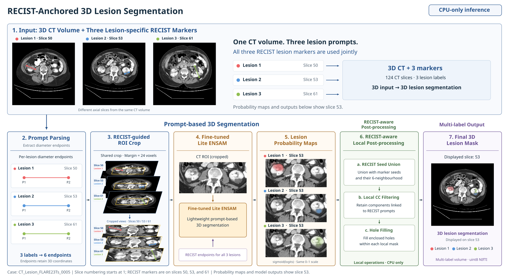

# RECIST-Anchor: Lightweight RECIST-Anchored 3D Lesion Segmentation for CPU-only Inference

This repository contains the reproducibility package for our Subtask 2 submission to the CVPR 2026 Pan-cancer Segmentation challenge: RECIST-to-3D lesion segmentation from CT volumes under CPU-only inference constraints.

The method starts from the public Lite ENSAM implementation/checkpoint and integrates it through supervised fine-tuning, validation-based checkpoint selection, and RECIST-anchored inference-time post-processing. The final inference code is packaged as a CPU-only Docker submission and preserves multi-label lesion outputs.



## Main Results

Validation results are measured on the 49 public validation NPZ cases available locally.

| Method | Evaluation setting | DSC | NSD | Mean CPU time |
| --- | --- | ---: | ---: | ---: |
| Lite ENSAM public report | Reported by authors | 0.7606 | 0.7899 | - |
| Lite ENSAM public checkpoint | Same-machine rerun, actual RECIST | 0.6992 | 0.7471 | 4.03 s |
| Fine-tuned selected model only | Same-machine containerized evaluation | 0.7424 | 0.8005 | 3.98 s |
| RECIST CC + hole filling, network ROI margin 24 | Same-machine containerized evaluation | 0.7558 | 0.8185 | 8.83 s |
| Final method with localized post-processing | Same-machine containerized evaluation | **0.7615** | **0.8326** | **3.29 s** |

The official Task 2 runtime constraint is CPU-only inference with an 8 GB memory limit and a 60 s per-case failure threshold. In our official-like local validation run, no case exceeded 60 s.

## Repository Layout

```text
.
├── assets/                         # Paper figures and result visualizations
├── checklists/                     # Original MICCAI checklist templates
├── docs/                           # Filled reproducibility docs and experiment reports
├── experiments/                    # Lightweight summaries of validation experiments
├── paper/                          # LLNCS paper source and compiled PDF
├── scripts/                        # Utility scripts for Docker, evaluation, and training command examples
└── submission/                     # Final CPU-only Docker inference package
```

Large challenge datasets, validation outputs, and Docker tar archives are not tracked in this repository.

## Environment and Requirements

The submitted inference container is CPU-only.

Local validation environment used in the paper:

| Item | Setting |
| --- | --- |
| OS | Ubuntu Linux |
| CPU | Intel Core i9-10920X, 12 cores / 24 threads |
| RAM | 128 GB local memory; Docker also tested with `-m 8G` |
| Training GPUs | 2 x NVIDIA GeForce RTX 3090, 24 GB each |
| Inference GPU | None |
| Python | 3.8 in the Docker image |

Python dependencies for the final Docker are listed in `submission/requirements.txt`.

## Dataset

The challenge provides unified NPZ files for Subtask 2. Each input case is expected to contain:

- `imgs`: 3D CT lesion image, shape `(Z, Y, X)`, intensity range `[0, 255]`
- `recist`: RECIST diameter marker, shape `(Z, Y, X)`, nonzero lesion labels
- `spacing`: spacing of the raw image, shape `(3,)`
- `direction`: direction of the raw image, shape `(9,)`
- `origin`: origin of the raw image, shape `(3,)`

For validation/evaluation only, NPZ files may also contain:

- `gts`: 3D lesion mask, shape `(Z, Y, X)`

Expected folder structure:

```text
PanCancerSeg_Test/
├── case_0001.npz
├── case_0002.npz
└── ...
```

## Preprocessing

No expensive preprocessing is performed during inference. The challenge already provides intensity-normalized NPZ files. The method operates directly in the provided voxel grid and uses RECIST-localized inference/post-processing to avoid full-volume operations where possible.

During inference, the implementation deliberately loads only keys needed for prediction and ignores `gts` if it is present.

## Inference

### Docker Build

From the repository root:

```bash
bash scripts/build_docker.sh medai:latest
```

This runs:

```bash
docker build -t medai:latest submission
```

### Docker Run: Challenge-style CPU-only Task 2

```bash
docker container run \
  -m 8G \
  --name medai \
  --rm \
  -v $PWD/PanCancerSeg_Test/:/workspace/inputs/ \
  -v $PWD/medai_outputs/:/workspace/outputs/ \
  medai:latest \
  /bin/bash -c "sh predict.sh"
```

The output folder contains one NIfTI segmentation per input NPZ:

```text
medai_outputs/
├── case_0001.nii.gz
├── case_0002.nii.gz
└── ...
```

Outputs are `uint8` multi-label lesion masks. For multi-lesion cases, labels such as `1`, `2`, `3`, and `4` are preserved rather than collapsed to binary.

## Evaluation

For local validation NPZ files containing `gts`, use:

```bash
python scripts/evaluate_npz_predictions.py \
  --gt_npz_dir /path/to/validation_npz \
  --pred_dir /path/to/medai_outputs \
  --out_csv /path/to/metrics.csv \
  --tolerance_mm 2.0
```

The script computes per-case DSC and NSD using the NPZ ground-truth labels and spacing. It is intended for local reproducibility checks and mirrors the official-style use of spacing-aware surface distance.

## Training and Checkpoint Selection

The final checkpoint was initialized from the public Lite ENSAM checkpoint and selected by public validation DSC/NSD after supervised fine-tuning.

Selected training configuration:

| Item | Setting |
| --- | --- |
| Initialization | Public Lite ENSAM checkpoint |
| Strategy | Supervised fine-tuning / validation checkpoint selection |
| Batch size | 1 |
| Total fine-tuning iterations | 12,000 |
| Epoch schedule | 2 fixed-length pseudo-epochs, 6000 iterations each |
| Learning rate | `1e-4` |
| Weight decay | `1e-4` |
| Loss | DiceCE |
| Selected checkpoint | Best validation Dice checkpoint |
| Parameters | 1.32M |

An example parameterized command is provided at:

```bash
scripts/finetune_selected_checkpoint_example.sh
```

The repository focuses on reproducing the final CPU-only inference package. Historical full training logs and large intermediate checkpoints are excluded.

## Post-processing

The final RECIST-aware post-processing:

1. Parses each nonzero RECIST label independently.
2. Adds the RECIST marker and its 3D radius-1 neighborhood as foreground seed voxels.
3. Retains connected components intersecting the corresponding RECIST marker.
4. Applies hole filling to the retained local component.
5. Restricts connected-component and hole-filling operations to a local bounding box around the predicted lesion and RECIST marker.

This local implementation produced zero voxel differences compared with full-volume post-processing on the tested validation cases while avoiding severe runtime failures on thick CT scans.

## Reproducibility Notes

- The final Docker inference package is included under `submission/`.
- The final fine-tuned weight file is included as `submission/weights.pth`.
- The original challenge data are not redistributed.
- The public Lite ENSAM implementation/checkpoint is acknowledged as the starting point.
- No private external dataset, private pretrained model, pseudo labels from previous FLARE winning algorithms, or algorithm distillation was used.

## Acknowledgements

We thank the challenge organizers and data contributors for providing the Pan-cancer Segmentation benchmark. We also acknowledge the public Lite ENSAM repository/checkpoint as the starting point for this work.
